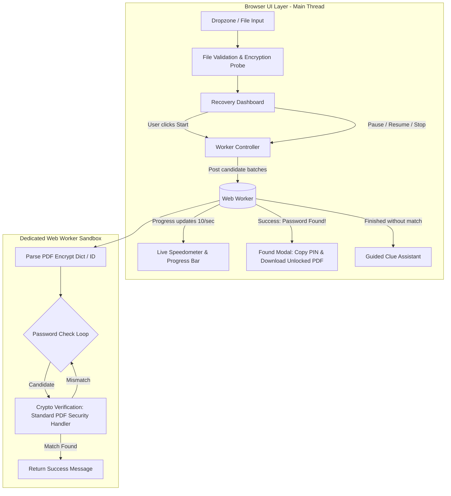

# Technical Specification: PDF Password & PIN Recovery Tool

**Tool Path:** `/tools/recover-pdf-password`  
**Tool Name:** PDF Password Recovery (Find Forgotten PIN / Password)  
**Target Platform:** AirPDF (Cloudflare Pages, Client-Side WebAssembly / JS)  
**Author:** AI Architecture & Pair Programming Team  
**Date:** October 16, 2026  
**Status:** Approved by User

---

## 1. Executive Summary & Problem Definition

### 1.1 The Problem
Users frequently lock personal PDF files (such as e-books, scans, payslips, or financial records) with numeric PINs or familiar passwords, only to forget them later. Because modern PDFs employ AES-128 or AES-256 encryption, the underlying document streams are mathematically scrambled. Standard PDF unlock tools require the user to already know the password. If the user forgets the password, they are left stranded.

### 1.2 The Solution
AirPDF will introduce a dedicated **PDF Password & PIN Recovery Tool** (`/tools/recover-pdf-password`). The tool runs 100% in the user's browser using background Web Workers to systematically test candidate passwords against the PDF's cryptographic header without freezing the UI or sending any bytes to external servers.

### 1.3 Key Objectives
1. **Automated Multi-Stage Recovery:** A one-click "Smart Recovery" pipeline that sequentially tests:
   - Phase 1: Instant Quick Check (Empty password / permissions check, Top 100 common passwords).
   - Phase 2: Complete 4-digit numeric PIN sweep (`0000` through `9999` = 10,000 combinations).
   - Phase 3: Common 6-digit PIN patterns and 4-digit year ranges (`1940`–`2030`).
   - Phase 4: Guided memory clue permutations (author, title, personal year, keywords).
   - Phase 5: Custom user wordlist (paste or upload).
2. **Zero-UI-Lag Performance:** Dedicated Web Worker execution with batched progress reporting (yielding 60fps UI responsiveness and battery-friendly operation).
3. **Instant Resolution & 1-Click Decrypt:** When the password is discovered, the UI displays the password with a copy button AND provides a one-click **"Download Clean Unlocked PDF"** button (permanently stripping the password using `pdf-lib-with-encrypt`).
4. **Privacy & Security Guarantee:** Zero cloud uploads. All decryption and candidate testing remain strictly inside browser memory.

---

## 2. System Architecture



### 2.1 File & Directory Layout
```
src/
├── content/tools/
│   └── recover-pdf-password.md          # Tool metadata, SEO, FAQs, how-to guide
├── components/tools/
│   └── RecoverPdfPasswordIsland.astro   # Interactive UI Island with worker lifecycle
├── lib/pdf/
│   ├── recover.ts                       # Candidate generators (4-digit, years, clues)
│   ├── worker-client.ts                 # Worker controller, state machine, speed meter
│   └── unlock.ts                        # Existing decryption engine (used on match)
public/
└── workers/
    └── pdf-recovery.worker.js           # Lightweight standalone PDF crypto verification worker
```

---

## 3. Multi-Stage Recovery Strategy

When a user has "no clue" what their password was, the recovery engine prioritizes based on statistical likelihood and computational speed:

| Stage | Strategy Name | Candidates | Approx. Duration (in JS Worker) | Rationale |
| :--- | :--- | :--- | :--- | :--- |
| **Stage 1** | **Instant Quick Check** | ~150 candidates | < 1 second | Checks empty string (owner-locked PDFs), common defaults (`password`, `123456`, `admin`, `pdf`, `book`, etc.). |
| **Stage 2** | **Full 4-Digit PIN Scan** | 10,000 (`0000`–`9999`) | ~30–60 seconds | The vast majority of forgotten short passwords on personal files and slips are 4-digit numeric PINs. |
| **Stage 3** | **Common 6-Digit PINs & Years** | ~3,500 candidates | ~10–15 seconds | Tests `1940`–`2030` (birth years, graduation years) and top 2,000 frequent 6-digit numeric PINs (e.g. `123456`, `000000`, `112233`, `258025`). |
| **Stage 4** | **Guided Memory Clues** | Variable (100–5,000) | 1–5 seconds | Generates smart permutations from user keywords (e.g. author name, title, nicknames) with variations: lowercase, UPPERCASE, TitleCase, suffix `123`, `!`, `2024`. |
| **Stage 5** | **Custom Wordlist** | User-defined | User-controlled | Allows pasting any suspect passwords or wordlists. |

---

## 4. Web Worker & Cryptographic Engine Design

### 4.1 Candidate Verification Mechanics
Testing candidate passwords in PDF requires evaluating the PDF standard security handler:
- For **RC4-40, RC4-128, and AES-128 (Revisions 2, 3, 4)**: Key derivation applies MD5 or SHA-1 with document ID and permissions. Candidate verification compares the generated test hash against the document's `/O` or `/U` entries.
- For **AES-256 (Revision 5 / Extension Level 3 and Revision 6 / ISO 32000-2)**: Key derivation uses SASLprep and iterative SHA-256 / SHA-384 / SHA-512 hashes.
- The Web Worker will use a lightweight, specialized verification loop based on standard PDF crypto specifications to achieve maximum throughput (hundreds of attempts per second) without re-parsing the entire DOM or document tree on each attempt.

### 4.2 Worker Communication Protocol
- **From UI to Worker:**
  - `{ action: 'INIT', pdfBytes: ArrayBuffer }`
  - `{ action: 'START_STAGE', stageId: 'pin4' | 'common' | 'clues' | 'custom', candidates?: string[] }`
  - `{ action: 'PAUSE' }`
  - `{ action: 'RESUME' }`
  - `{ action: 'STOP' }`
- **From Worker to UI:**
  - `{ type: 'READY', cipher: 'AES-128' | 'AES-256' | 'RC4', estimatedSpeed: number }`
  - `{ type: 'PROGRESS', tested: number, total: number, currentCandidate: string, speed: number }` (throttled to 10 FPS)
  - `{ type: 'FOUND', password: string }`
  - `{ type: 'EXHAUSTED', stageId: string }`
  - `{ type: 'ERROR', message: string }`

---

## 5. User Interface & User Experience (UX)

### 5.1 Interactive States
1. **Dropzone State:** Clean drag-and-drop area accepting `.pdf` files with client-side probe.
2. **Analysis State:** Confirms encryption type (e.g. "AES-128 Encrypted", "No File Uploaded to Cloud").
3. **One-Click Recovery Dashboard:**
   - Primary Action: **"Start Smart Recovery (Recommended)"** — starts Stage 1, then automatically advances to Stage 2 (4-Digit PINs), then Stage 3.
   - Tabs for manual selection: `[ Smart Auto-Scan ]` `[ 4-Digit PINs ]` `[ Clue Permutations ]` `[ Custom List ]`.
4. **Live Scanning Dashboard:**
   - Animated pulse & real-time speedometer (e.g., `420 tests / sec`).
   - Progress bar with percentage and estimated time remaining (ETA).
   - "Currently testing: `••••` (e.g., `4821` / `9999`)".
   - Controls: **Pause**, **Resume**, **Cancel**.
5. **Success Celebration State:**
   - Large green success badge with confetti-like styling.
   - **Password Revealed Box:** `[ 1984 ]` with a 1-click **Copy Password** button.
   - Primary CTA: **"Download Decrypted PDF"** (immediately invokes `unlockPdf` client-side so the user gets a permanent unencrypted copy).
6. **Exhausted State (Helpful Next Steps):**
   - If 4-digit PINs and common passwords don't match, the UI presents an interactive **Guided Memory Helper**:
     - "Do you remember the author or book title?"
     - "Do you remember what year you got it?"
     - One-click button: "Generate Clue Variations & Test".

---

## 6. Integration Across AirPDF

1. **New Route:** `/tools/recover-pdf-password` added to tool routing and navigation.
2. **Unlock PDF Integration:** On `/tools/unlock-pdf`, right below the password input field:
   > *Forgot the password? [Use our in-browser Password Recovery tool →](/tools/recover-pdf-password)*
3. **Navigation & SEO:**
   - Added to Navigation bar under "All Tools" and footer navigation.
   - Content collection entry with schema markup (`WebApplication`, `FAQPage`, `BreadcrumbList`).

---

## 7. Verification & Testing Plan

1. **Unit Tests (Vitest):**
   - Permutation generation (casing, suffixes, dates).
   - 4-digit sequential PIN generator (`0000` to `9999` integrity).
   - Core candidate tester on synthetic encrypted test PDFs.
2. **Integration & Build Verification:**
   - Astro static site build check (`npm run build`).
   - Zero compilation/linter errors.
3. **Functional Browser Verification:**
   - Test against a password-protected PDF with a 4-digit PIN (e.g., `1234`).
   - Verify that the worker scans, identifies `1234`, reports the match, and produces the clean decrypted PDF.
   - Verify mobile responsiveness and ensure the browser thread remains smooth during scanning.
4. **Production Deployment:**
   - Deploy to Cloudflare Pages (`airpdf` and `pdfzero`).
   - Verify live SSL URLs and verify client-side offline execution.

---

## 8. Feedback & Approval Gate
Status: Approved by User.
