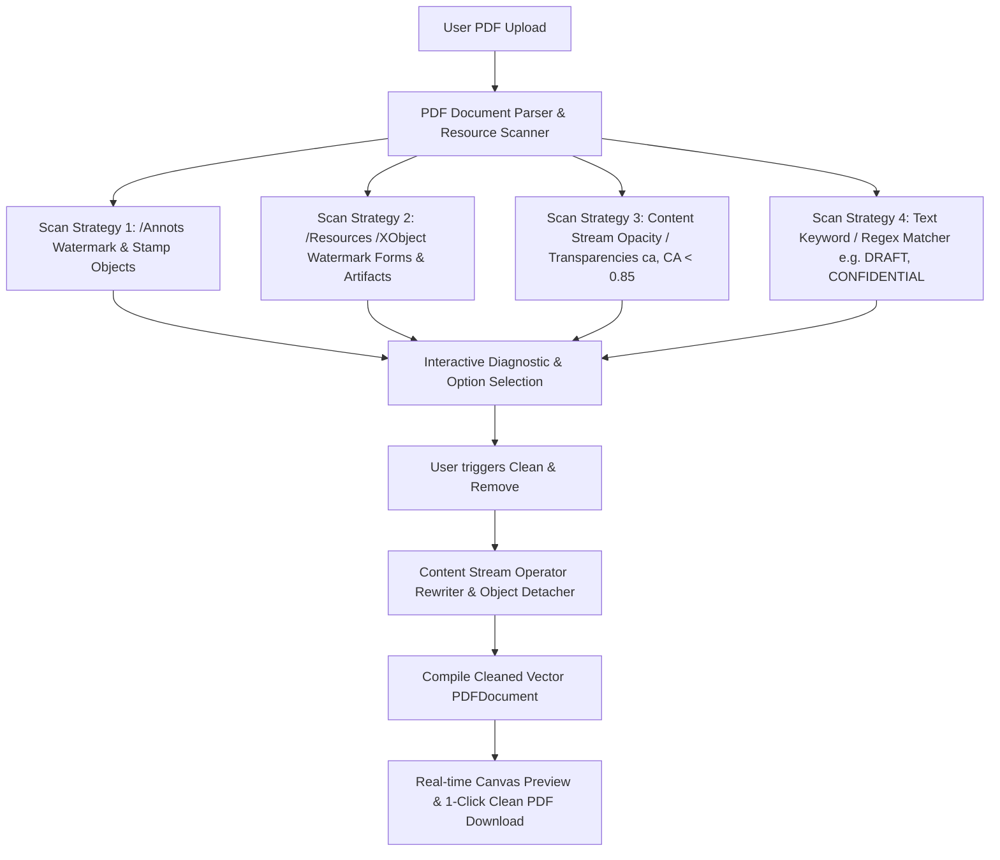

# Technical Specification: PDF Watermark & Stamp Remover

**Tool Path:** `/tools/remove-watermark`  
**Tool Name:** PDF Watermark & Stamp Remover (Clean Vector & Stamp Eraser)  
**Target Platform:** AirPDF (Cloudflare Pages, Client-Side WebAssembly / JS)  
**Author:** AI Architecture & Pair Programming Team  
**Date:** October 17, 2026  
**Status:** In Progress / Design Complete

---

## 1. Executive Summary & Problem Definition

### 1.1 The Problem
Watermarks, draft stamps, sample markers, and proprietary platform overlays (e.g. "CONFIDENTIAL", "DRAFT", "EVALUATION COPY", corporate logos) are frequently embedded into PDF documents. Users need to remove them for clean archiving, printing, or client presentation.
However:
1. **Paid Paywalls:** Commercial tools (e.g. Sejda, iLovePDF, Adobe Acrobat Pro) charge monthly subscriptions or lock the removal behind paywalls.
2. **Destructive Rasterization:** Free converters typically convert every PDF page into a low-resolution raster image, destroying selectable text, searchability, hyperlinks, and vector sharpness, while inflating file sizes tenfold.
3. **Privacy Vulnerabilities:** Sensitive contracts, legal briefs, and personal records are uploaded to unknown third-party cloud servers.

### 1.2 The Solution: AirPDF Watermark Remover
AirPDF provides a **100% in-browser, privacy-first PDF Watermark & Stamp Remover** that:
- Runs entirely in client-side memory using `pdf-lib-with-encrypt` and client stream analysis.
- Removes watermarks at the object and vector operator level without rasterizing the document.
- Preserves 100% of selectable text, fonts, links, and vector graphics.
- Provides automatic multi-strategy detection (annotations, XObjects, low-opacity content streams, keyword matches) plus an interactive real-time visual preview.

---

## 2. Technical Architecture & Removal Strategies

### 2.1 The 4 Core Removal Engines (`src/lib/pdf/watermark.ts`)

1. **Engine 1: Annotations Stripper (`/Annots`)**
   - Scans each page's annotation dictionary (`page.node.Annots()`).
   - Identifies annotations where `/Subtype` is `/Watermark`, `/Stamp`, or where annotation contents match watermark strings.
   - Removes them from the page's annotation array.

2. **Engine 2: Artifact & Form XObject Stripper (`/XObject`)**
   - Inspects `/Resources /XObject` dictionaries across all pages.
   - Detects Form XObjects whose names or metadata signify watermarking (e.g., `/Watermark`, `/Wm*`, or recurring backdrop templates applied to every page).
   - Detaches the XObject and removes corresponding `Do` operator invocations from the content streams.

3. **Engine 3: Low-Opacity & Graphic State Neutralizer**
   - Many watermarks are drawn in the page content stream with reduced opacity via ExtGState (e.g. `ca 0.2`, `CA 0.3`, `BM /Multiply`).
   - The engine scans content stream tokens: when a graphic state setting low opacity (< 0.85) is applied to text or fill operators without underlying images, the engine filters or zeroes out the rendering instructions (`3 Tr` = invisible text or strips the `Tj`/`TJ` block).

4. **Engine 4: Keyword & Pattern Filter**
   - Allows automatic detection or custom user entry for phrases like "CONFIDENTIAL", "DRAFT", "SAMPLE", "WATERMARK", "COPY", or custom website URLs.
   - Replaces matching text draw calls with whitespace/noop while keeping document layout intact.

---

## 3. User Interface & Experience (`RemoveWatermarkIsland.astro`)

1. **Drag-and-Drop Area:** Instant file loading with zero upload delay.
2. **Detection Summary Card:**
   - Displays detected watermarks (e.g. *"Found 4 Watermark Annotations, 1 Semi-Transparent Overlay Layer, and detected keyword 'DRAFT'"*).
3. **Configurable Removal Controls:**
   - Checkbox: Strip Watermark Annotations & Stamps (Recommended, default ON).
   - Checkbox: Strip Semi-Transparent Layers & Artifacts (default ON).
   - Checkbox: Strip Keyword Matches with text field (pre-filled with detected text or customizable).
4. **Live Interactive Before / After Preview:**
   - Side-by-side or toggle preview using PDF.js canvas showing the original page vs. the cleaned page.
5. **Download Action:**
   - Download cleaned PDF with filename `<original>_nowatermark.pdf`.
   - Comprehensive diagnostic badge: *"Cleaned X watermarks across Y pages in 0.4s"*.

---

## 4. Dual Audit Verification Criteria

1. **AI Security & Code Audit:**
   - 100% client-side: Zero external network transmissions (verified via network monitor).
   - Text selectable: Document text must remain selectable and sharp (zero rasterization).
   - Schema markup: JSON-LD WebApplication, FAQPage, BreadcrumbList schemas.
   - Unit tests: Vitest test suite covering annotation stripping, XObject detachment, keyword filtering, and full round-trip generation.
2. **Human UX Audit:**
   - Responsive design on mobile (< 375px), tablet, and desktop.
   - Clear visual feedback during file scanning and processing.
   - Clean, professional typography with SVG icons.
   - Direct integration into site header, homepage tools grid, and footer.
