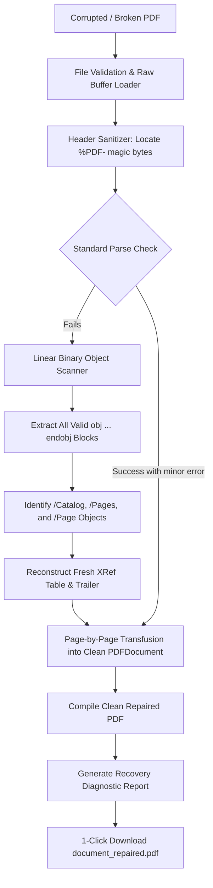

# Technical Specification: PDF Repair & Content Rescuer

**Tool Path:** `/tools/repair-pdf`  
**Tool Name:** PDF Repair & Content Rescuer (Fix Corrupted / Damaged PDFs)  
**Target Platform:** AirPDF (Cloudflare Pages, Client-Side WebAssembly / JS)  
**Author:** AI Architecture & Pair Programming Team  
**Date:** October 17, 2026  
**Status:** Approved by User

---

## 1. Executive Summary & Problem Definition

### 1.1 The Problem
PDF documents often become unopenable due to:
- Interrupted or truncated web downloads (missing `%%EOF` or trailer).
- Corrupted byte offsets in the cross-reference (`xref`) table.
- Leading server junk bytes (e.g., PHP warnings, HTML headers, or BOM before `%PDF-`).
- Corrupted catalog `/Root` or `/Pages` object trees.
- Damaged object streams on single pages that crash standard viewers like Adobe Acrobat, Google Chrome, and Apple Preview with *"The document is damaged and cannot be repaired"*.

Most web services either fail to process these files or demand that users upload confidential documents to remote servers.

### 1.2 The Solution
AirPDF will introduce a dedicated **PDF Repair & Content Rescuer** (`/tools/repair-pdf`). Operating 100% client-side in the user's browser, the engine bypasses broken metadata pointers, performs a linear binary scan of all intact objects, reconstructs a clean cross-reference table and catalog, and re-encodes all salvageable pages into a clean, standards-compliant PDF.

### 1.3 Key Objectives
1. **Multi-Strategy Recovery Pipeline:**
   - Strategy 1: Header & Stream Sanitization (strip leading/trailing junk, normalize magic bytes `%PDF-`).
   - Strategy 2: Missing Trailer & `%%EOF` Synthesis.
   - Strategy 3: Complete XRef Table Rebuilding from raw object offsets.
   - Strategy 4: Page-by-Page Object Salvage (copies all surviving pages into a brand new container even if some objects are corrupted).
2. **Transparent Diagnostic Report:** Provides users with a clear audit of what was fixed (e.g., *"Recovered 14/14 pages"*, *"Rebuilt broken XRef table"*, *"Stripped 240 bytes of invalid header data"*).
3. **Zero Server Uploads:** 100% client-side in-browser memory execution.
4. **Dual Audit Gate:** Human UI/UX verification + AI code/security audit before proceeding to the next tool.

---

## 2. System Architecture



### 2.1 File & Directory Layout
```
src/
├── content/tools/
│   └── repair-pdf.md                  # Tool metadata, SEO, FAQs, how-to guide
├── components/tools/
│   └── RepairPdfIsland.astro          # Interactive UI Island with live repair diagnostics
├── lib/pdf/
│   └── repair.ts                      # Core binary scanner, XRef rebuilder, page rescuer
tests/
└── pdf/
    └── repair.test.ts                 # Unit tests on simulated corrupted PDFs
```

---

## 3. Core Engine Mechanics (`src/lib/pdf/repair.ts`)

### 3.1 Input & Output Interface
```typescript
export interface RepairReport {
  repairedBytes: Uint8Array;
  originalSize: number;
  repairedSize: number;
  pagesRecovered: number;
  fixesApplied: string[];
  isFullyRestored: boolean;
}

export async function repairPdf(
  file: File,
  onProgress?: (progress: { message: string; percent: number }) => void
): Promise<RepairReport>;
```

### 3.2 Recovery Stages
1. **Header Normalization:** Slices the buffer to start exactly at `%PDF-1.x`. Strips BOM, HTTP headers, or junk bytes.
2. **EOF & Trailer Repair:** Checks for `%%EOF` within the last 1024 bytes. If missing, scans for the root catalog object and synthesizes a valid trailer.
3. **Linear Object Reconstruction:** Uses a regex/byte scanner `(\d+)\s+(\d+)\s+obj` to locate every indirect object, calculates exact 10-digit byte offsets, and generates a standard `/xref` table.
4. **Resilient Document Loading:** Loads the reconstructed buffer into `PDFDocument.load()` with error recovery options.
5. **Page Transfusion:** If the document has isolated corrupted pages, iterates through each page index, copying intact pages into a new clean `PDFDocument.create()`.

---

## 4. User Experience & UI States

1. **Dropzone:** Accepts `.pdf` files of any size with badges: *"100% In-Browser"*, *"Zero Uploads"*, *"No Size Cap"*.
2. **Live Repairing State:** Animated wrench/shield icon with real-time status:
   - *"Scanning binary streams for intact pages..."*
   - *"Reconstructing cross-reference table..."*
   - *"Assembling clean standard PDF..."*
3. **Diagnostic Success State:**
   - Green success badge: *"PDF Successfully Repaired!"*
   - Diagnostic Breakdown Card:
     - 📄 **Pages Salvaged:** e.g., `12 pages recovered`
     - 🔧 **Fixes Applied:** Bulleted list (e.g., `Fixed corrupted XRef table offsets`, `Restored missing EOF trailer`, `Normalized header`)
     - 📊 **File Size:** Original vs Repaired size comparison
   - Primary Action: **"Download Repaired PDF"** (`[filename]_repaired.pdf`).
   - Secondary Action: **"Repair Another PDF"**.
4. **Unrecoverable State (Edge Case):**
   - If the file contains 0 valid PDF objects (e.g. it's an MP3 or completely zeroed bytes), clearly explains what happened and why it cannot be reconstructed.

---

## 5. Dual Audit Verification Criteria

Before completing Tool 1 and moving to Tool 2, the following must pass:
1. **Human Audit:**
   - Dropzone functions with drag-and-drop and native file picker.
   - Clean UI alignment on mobile (< 375px) and desktop (> 1200px).
   - Clear diagnostic feedback explaining what was repaired.
   - Downloaded file opens cleanly in Chrome, Edge, and Adobe Reader.
   - Navigation links in Header, Footer, and Homepage work without 404s.
2. **AI / Code Audit:**
   - Vitest unit tests pass 100% on simulated corrupted files (missing EOF, broken xref, leading junk).
   - `npm run build` succeeds with 0 errors, 0 warnings.
   - 100% client-side: 0 external network requests during file processing.
   - Valid JSON-LD schema (`WebApplication`, `FAQPage`, `BreadcrumbList`).

---

## 6. Feedback & Approval Gate
Status: Approved by User.
