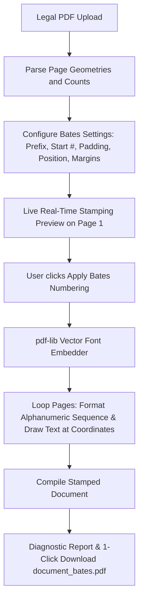

# Technical Specification: Legal Bates Numbering & Stamp Stacker

**Tool Path:** `/tools/bates-numbering`  
**Tool Name:** Legal Bates Numbering & Stamp Stacker (Discovery & Litigation Page Indexer)  
**Target Platform:** AirPDF (Cloudflare Pages, Client-Side WebAssembly / JS)  
**Author:** AI Architecture & Pair Programming Team  
**Date:** October 18, 2026  
**Status:** In Progress / Design Complete

---

## 1. Executive Summary & Problem Definition

### 1.1 The Problem
In legal practice, corporate compliance, judicial discovery, government audits, and patent prosecution, documents submitted for evidence must bear **Bates Numbers**—sequential alphanumeric reference stamps (e.g. `PLTF-000001`, `CONF-000420`, `EXHIBIT-A-001`).
- Commercial suites (Adobe Acrobat Pro, LexisNexis, CaseNotebook) lock Bates stamping behind costly enterprise licenses ($25–$100+/user/month).
- Uploading confidential legal exhibits, deposition transcripts, or proprietary contracts to generic web converters violates client attorney-client privilege and GDPR/HIPAA confidentiality obligations.

### 1.2 The Solution: AirPDF In-Browser Bates Numbering
AirPDF provides a **100% in-browser, client-side Legal Bates Numbering engine**:
1. **Zero Cloud Transmission:** Sensitive evidence files and discovery bundles never leave the attorney's or paralegal's browser.
2. **Flexible Bates Pattern Engine:** Configurable Prefix, Starting Number, Number of Digits (zero-padding), Suffix, and Step increment.
3. **Multi-Position Precision:** Stamping in 6 standard positions (Top-Left, Top-Center, Top-Right, Bottom-Left, Bottom-Center, Bottom-Right) with customizable margin insets.
4. **Vector Quality:** Direct vector font embedding using `pdf-lib`; stamps are crystal clear on screen and when printed, never rasterized.

---

## 2. Technical Architecture & Stamping Flow

### 2.1 Core Bates Engine Modules (`src/lib/pdf/bates.ts`)

1. **Bates Formatter (`formatBatesNumber`):**
   Combines `prefix + String(currentNumber).padStart(digits, '0') + suffix`.
   Example: `PLTF-` + `000001` + `-CONF` -> `PLTF-000001-CONF`.

2. **Coordinate Calculator (`calculateBatesCoordinates`):**
   Calculates `(x, y)` based on page width, page height, position enum (`topLeft`, `topCenter`, `topRight`, `bottomLeft`, `bottomCenter`, `bottomRight`), text width, and margin offsets.

3. **Master Stamping Function (`applyBatesNumbering`):**
   Iterates through pages and applies vector text stamps at computed coordinates. Returns clean `Uint8Array` + report.

---

## 3. UI/UX Design (`src/components/tools/BatesNumberingIsland.astro`)

1. **Dropzone:** Drag & drop multi-page legal document.
2. **Bates Configuration Form:**
   - Prefix (e.g. `CONF-`)
   - Starting Number (e.g. `1`)
   - Number of Digits (e.g. `6` -> `000001`)
   - Suffix (e.g. ` (EXHIBIT 1)`)
   - Position selector (6 visual buttons)
   - Font size slider (8pt to 16pt, default 10pt)
   - Color picker (Black / Dark Gray / Navy)
3. **Summary & Action:**
   - Shows range preview: e.g. `CONF-000001` to `CONF-000045`.
   - Action Button: "Apply Bates Numbers & Download".
4. **Instant Download:** `<original>_bates.pdf`.

---

## 4. Dual Audit Verification Criteria

1. **AI Security & Code Audit:**
   - Verify zero network requests during stamping.
   - Verify Bates string sequence across all pages.
   - Vitest unit tests for numbering format, position calculations, and round-trip PDF generation.
   - Schema markup: JSON-LD WebApplication, FAQPage, BreadcrumbList.
2. **Human UX Audit:**
   - Responsive layout across mobile and desktop.
   - Clean legal typography and clear position selector.
   - Downloaded PDF verified with standard viewers.
