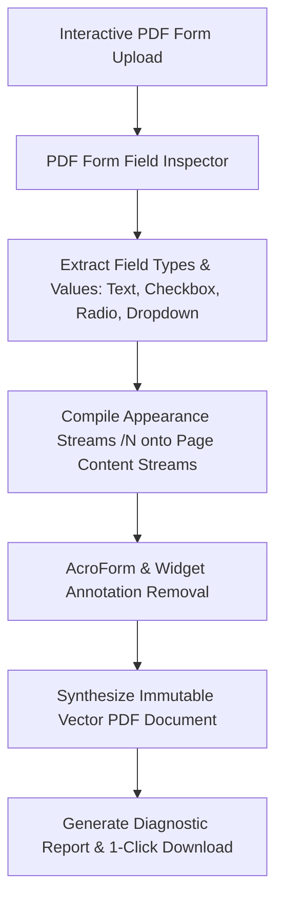

# Technical Specification: PDF Form Flattener

**Tool Path:** `/tools/flatten-pdf`  
**Tool Name:** PDF Form Flattener (Lock Fillable Forms into Permanent Documents)  
**Target Platform:** AirPDF (Cloudflare Pages, Client-Side WebAssembly / JS)  
**Author:** AI Architecture & Pair Programming Team  
**Date:** October 18, 2026  
**Status:** In Progress / Design Complete

---

## 1. Executive Summary & Problem Definition

### 1.1 The Problem
Interactive PDF forms (AcroForms) with fillable text inputs, checkboxes, radio buttons, and digital signatures are problematic when submitting official documents:
- Different PDF viewers (Google Chrome, Apple Preview, Adobe Reader, mobile viewers) render form fields inconsistently, often displaying filled fields as blank!
- Fillable fields remain editable by recipients, creating legal and tamper risks in contracts, invoices, and loan applications.
- E-filing court systems, tax portals, and university admissions require flattened PDFs to ensure immutability and archival compliance (PDF/A).

Commercial editors charge $15–$25/month for flattening, and free web tools rasterize pages into blurry images or upload private financial filings to remote cloud servers.

### 1.2 The Solution: AirPDF In-Browser Form Flattener
AirPDF provides a **100% in-browser, lossless PDF Form Flattener**:
1. **True Vector Flattening:** Locks form input values, check marks, and signatures into the permanent visual content stream. No blurry rasterization; text remains sharp and vector-crisp.
2. **Widget & AcroForm Stripping:** Safely purges interactive widget annotations and the `/AcroForm` dictionary from the document catalog, making tampering impossible.
3. **Archival & E-Filing Compliance:** Guarantees that every recipient, printer, and mobile reader sees the exact same filled-in values.
4. **100% Private & Free:** Zero server uploads, zero cost, unlimited pages.

---

## 2. Technical Architecture & Flattening Engine

### 2.1 Core Flattener Modules (`src/lib/pdf/flatten.ts`)

1. **Form Field Inspector (`inspectFormFields`):**
   - Counts total interactive fields, filled text inputs, checkboxes, and signatures.
2. **Form Flattener (`flattenPdfForm`):**
   - Calls `form.flatten()` in `pdf-lib`, which translates all current field values and visual appearance streams directly into page operators.
   - Deletes interactive `/AcroForm` catalog reference.
   - Saves clean, immutable PDF bytes.

---

## 3. UI/UX Design (`src/components/tools/FlattenPdfIsland.astro`)

1. **Dropzone:** Drag and drop fillable PDF.
2. **Form Inspection Card:**
   - Detects and displays: *"Found N interactive form fields (Text inputs, Checkboxes, Signatures)"*.
3. **Action Button:** "Flatten Form & Make Immutable".
4. **Success Card:**
   - *"Successfully flattened N form fields across M pages."*
   - *"100% Vector Quality Preserved — Form fields are now permanent and tamper-proof."*
   - Download Button: `<filename>_flattened.pdf`.

---

## 4. Dual Audit Verification Criteria

1. **AI Security & Code Audit:**
   - Verify output document has 0 interactive form fields (`form.getFields().length === 0`).
   - Verify text remains vector sharp and selectable.
   - Vitest test suite testing AcroForm flattening and widget removal.
   - Schema markup: JSON-LD WebApplication, FAQPage, BreadcrumbList.
2. **Human UX Audit:**
   - Dropzone with drag & drop and field count detection.
   - Clear diagnostic success card with file size and field count.
   - 1-click clean download.
