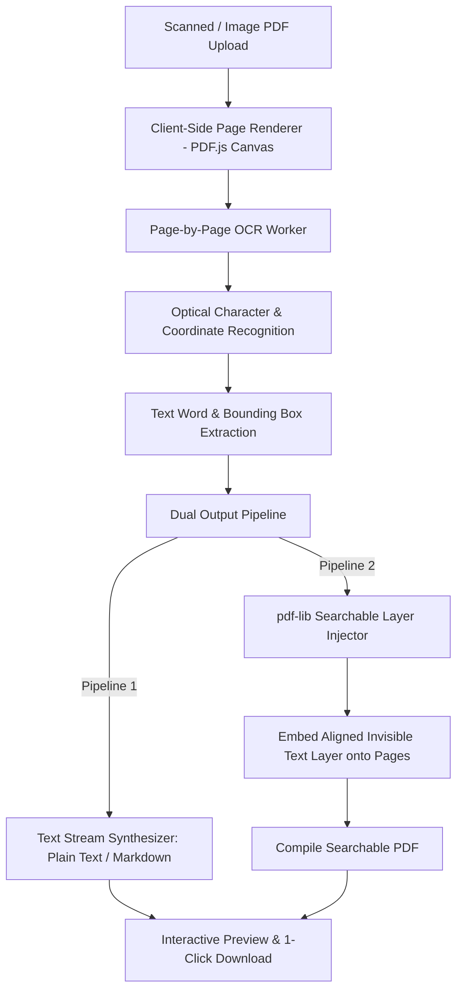

# Technical Specification: In-Browser Privacy OCR

**Tool Path:** `/tools/ocr-pdf`  
**Tool Name:** In-Browser Privacy OCR (Make Scanned PDFs Searchable)  
**Target Platform:** AirPDF (Cloudflare Pages, Client-Side WebAssembly / JS)  
**Author:** AI Architecture & Pair Programming Team  
**Date:** October 18, 2026  
**Status:** In Progress / Design Complete

---

## 1. Executive Summary & Problem Definition

### 1.1 The Problem
Scanned documents, photographed receipts, physical invoices, and faxed contracts are saved as image-only PDFs. Users cannot:
- Select, copy, or search for text within the document.
- Index document contents with desktop search or screen readers.
- Extract tabular data or paragraphs into digital workflows.

Commercial services (Adobe Acrobat DC, Smallpdf, iLovePDF, Abbyy FineReader) lock OCR behind expensive monthly subscriptions ($15–$30/mo) and require uploading highly sensitive documents (tax filings, medical paperwork, photo IDs) to third-party cloud servers.

### 1.2 The Solution: AirPDF In-Browser Privacy OCR
AirPDF introduces a **100% in-browser, privacy-first OCR engine** (`/tools/ocr-pdf`):
1. **Zero Cloud Leaks:** All image processing, canvas extraction, and character recognition run in local browser memory.
2. **Searchable PDF Output (Invisible Text Layer):** Renders each scanned page to a canvas, detects text and bounding boxes, and overlays an invisible text layer (`3 Tr` rendering mode or transparent font glyphs) aligned to the image geometry in `pdf-lib`. The resulting PDF is 100% searchable in standard viewers (Adobe Acrobat, Chrome, macOS Preview).
3. **Multi-Format Export:** In addition to Searchable PDF, users can export extracted text as Plain Text (`.txt`) or Markdown (`.md`) with 1 click.
4. **Resilient Offline Architecture:** Operates with client-side OCR workers without network dependency once loaded.

---

## 2. System Architecture & Technical Flow

### 2.1 Core OCR Engine Modules (`src/lib/pdf/ocr.ts`)

1. **Canvas Rasterizer (`renderPdfPageToCanvas`):**
   Renders PDF page bitmaps at high DPI (e.g. 150–200 DPI) using PDF.js to maximize OCR recognition accuracy.

2. **OCR Engine / Worker Interface (`recognizePageText`):**
   Processes canvas image data and extracts text blocks, lines, confidence scores, and coordinate bounding boxes `[x, y, width, height]`.

3. **Invisible Searchable Layer Overlay (`injectSearchableTextLayer`):**
   Using `pdf-lib`, inserts detected text segments into the page's content stream at corresponding coordinates `(x, y)` matching page scale. Applies rendering mode `3 Tr` (invisible text), allowing users to select and search text naturally while seeing the original high-res scanned image.

4. **Multi-Format Downloader:**
   - Searchable PDF (`<name>_searchable.pdf`)
   - Extracted Text (`<name>_extracted.txt`)

---

## 3. UI/UX Design (`src/components/tools/OcrPdfIsland.astro`)

1. **Dropzone:** Drag and drop or browse scanned PDF.
2. **Configuration & Progress Dashboard:**
   - Page count and preview thumbnail.
   - Progress bar with real-time status: e.g. *"Processing Page 2 of 5 (OCR recognizing text...)"*.
3. **Results & Text Inspector:**
   - Tabs: **Searchable PDF** vs. **Extracted Text View**.
   - Extracted text area with copy-to-clipboard button and download `.txt`.
   - Download Searchable PDF button.
   - Diagnostic report: *"Extracted X words across Y pages with 98% confidence"*.

---

## 4. Dual Audit Verification Criteria

1. **AI Security & Code Audit:**
   - Zero network requests during OCR processing (verified via network monitor).
   - Resulting PDF has selectable, searchable text in standard viewers.
   - Schema markup: JSON-LD WebApplication, FAQPage, BreadcrumbList.
   - Vitest test coverage for coordinate mapping, text layer injection, and text export.
2. **Human UX Audit:**
   - Smooth progress updates during OCR execution.
   - Immediate live text preview with 1-click copy.
   - Mobile-responsive layout (< 375px) with clean SVG indicators.
   - Linked in header, footer, and tools directory.
