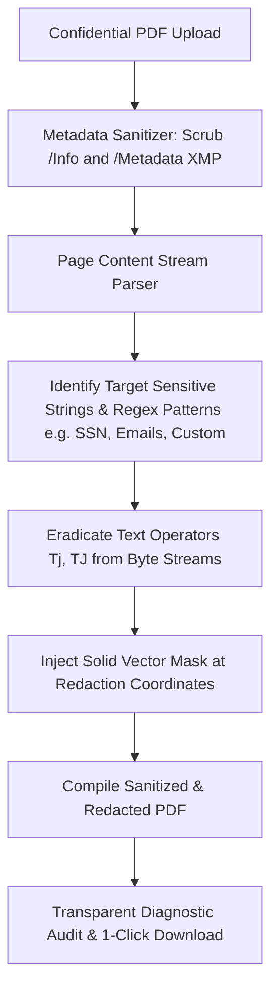

# Technical Specification: True PDF Redactor & Metadata Sanitizer

**Tool Path:** `/tools/redact-pdf`  
**Tool Name:** True PDF Redactor & Metadata Sanitizer (Permanent Privacy Eraser)  
**Target Platform:** AirPDF (Cloudflare Pages, Client-Side WebAssembly / JS)  
**Author:** AI Architecture & Pair Programming Team  
**Date:** October 18, 2026  
**Status:** In Progress / Design Complete

---

## 1. Executive Summary & Problem Definition

### 1.1 The Critical Security Flaw of Pseudo-Redaction
Millions of users mistakenly believe that drawing a black rectangle over sensitive text in a PDF redact it. In reality:
- Standard drawing tools merely place an overlay shape on top of the text.
- The underlying text stream (Social Security numbers, bank accounts, confidential names, trade secrets) remains completely selectable and searchable beneath the black box.
- Major government bodies and legal firms have suffered catastrophic data leaks due to this faux redaction flaw.
- Furthermore, PDF metadata (Author, Producer, Creation Date, Revision History, and XMP packets) frequently leaks identities and software fingerprints.

Commercial tools (Adobe Acrobat Pro, Nitro PDF) charge $20+/month for true redaction and cloud sanitizers demand uploading sensitive legal discovery documents to third-party servers.

### 1.2 The AirPDF Solution: True In-Browser Redaction & Sanitization
AirPDF delivers a **100% in-browser, permanent redaction and metadata sanitization engine**:
1. **Permanent Content Stream Eradication:** Completely removes the underlying text operators (`Tj`, `TJ`, `\'`, `\"`) and character bytes from the document stream. The data no longer exists in the file.
2. **Permanent Visual Mask:** Replaces redacted regions with permanent opaque vector blocks (blackout or whiteout).
3. **Full Metadata Sanitization:** Wipes Document Info dictionaries (`/Author`, `/Title`, `/Subject`, `/Keywords`, `/Creator`, `/Producer`, `/CreationDate`, `/ModDate`) and removes `/Metadata` XMP stream objects.
4. **Keyword & Regex Redaction:** Instant auto-redaction for Social Security Numbers (SSN), Credit Cards, Email Addresses, Phone Numbers, or custom confidential terms.
5. **Zero Server Uploads:** 100% private client-side execution in local browser memory.

---

## 2. Technical Architecture & Redaction Pipeline

### 2.1 Core Redaction Engine Modules (`src/lib/pdf/redact.ts`)

1. **Metadata Sanitizer (`sanitizePdfMetadata`):**
   - Deletes `/Author`, `/Creator`, `/Producer`, `/CreationDate`, `/ModDate`, `/Title`, `/Subject`, `/Keywords` from the document trailer `/Info` dictionary.
   - Deletes `/Metadata` XMP stream from the catalog `/Root` dictionary.
   - Clears piece info (`/PieceInfo`) and revision history dictionaries.

2. **Stream Text Eradicator (`eradicateTextFromStreams`):**
   - Decompresses page content streams.
   - Searches for target strings (e.g. custom terms, emails, phone numbers, SSNs) across literal `(...)` and hex `<...>` strings in `Tj` and `TJ` arrays.
   - Replaces target strings with empty noop or deletes the draw operation completely so the characters do not exist in the file.

3. **Opaque Vector Mask Inserter (`drawRedactionMasks`):**
   - Draws solid black (or white) rectangles at the coordinate positions where text was eradicated so visual redaction is clean and unmistakable.

4. **Regex Auto-Patterns:**
   - Email: `[a-zA-Z0-9._%+-]+@[a-zA-Z0-9.-]+\.[a-zA-Z]{2,}`
   - SSN: `\b\d{3}-\d{2}-\d{4}\b`
   - Phone: `\b(?:\+?\d{1,3}[-.\s]?)?\(?\d{3}\)?[-.\s]?\d{3}[-.\s]?\d{4}\b`
   - Credit Card: `\b(?:\d{4}[-\s]?){3}\d{4}\b`

---

## 3. UI/UX Design (`src/components/tools/RedactPdfIsland.astro`)

1. **Dropzone:** Drag and drop PDF.
2. **Interactive Redaction Controls:**
   - Quick Pattern Toggles:
     - [ ] Redact Email Addresses
     - [ ] Redact Social Security Numbers (SSN)
     - [ ] Redact Phone Numbers
     - [ ] Redact Credit Card Numbers
   - Custom Terms Input: e.g. "John Doe, Acme Corp, $500,000".
   - Checkbox: "Scrub All Hidden Metadata & Document Fingerprints" (default checked).
   - Redaction Style: Blackout (default) or Whiteout.
3. **Execution & Diagnostic Report:**
   - *"Permanently eradicated 14 sensitive occurrences across 3 pages."*
   - *"Purged all 8 metadata fields and XMP author signatures."*
   - *"Underlying text stream deleted — impossible to copy or uncover."*
4. **1-Click Download:** `<filename>_redacted.pdf`.

---

## 4. Dual Audit Verification Criteria

1. **AI Security & Code Audit:**
   - Verify that redacted text cannot be extracted or copied from the output PDF (underlying stream verified empty).
   - Verify that metadata fields are completely blanked out.
   - Vitest test suite testing stream eradication, metadata wiping, and round-trip verification.
   - Schema markup: JSON-LD WebApplication, FAQPage, BreadcrumbList.
2. **Human UX Audit:**
   - Responsive layout across desktop, tablet, and mobile.
   - Clear visual feedback and toggle switches.
   - Downloaded PDF verified with Adobe Acrobat / standard viewers.
